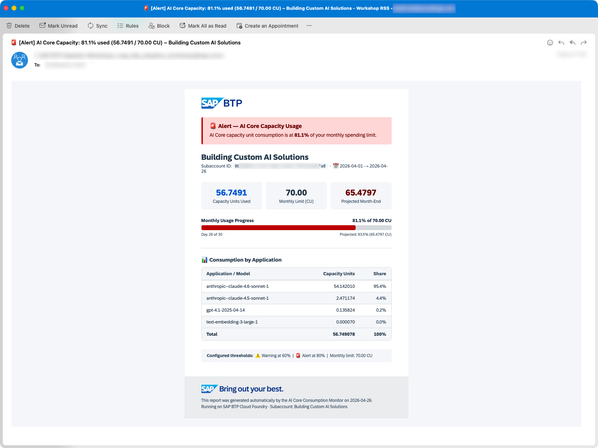

# AI Core Consumption Monitor

A Python background agent that runs on **SAP BTP Cloud Foundry** and monitors daily AI Core capacity unit consumption. When consumption approaches a configured monthly spending limit, it sends notifications via **SMTP email** or **SAP Alert Notification Service (ANS)**.

## How It Works

```
┌─────────────────────────────────────────────────────────────┐
│  SAP BTP Cloud Foundry                                      │
│                                                             │
│  ┌──────────────────────────────────────────────────────┐   │
│  │  ai-core-monitor (Python / Flask)                    │   │
│  │                                                      │   │
│  │  APScheduler ──► run_monitoring_job() [daily 07:00]  │   │
│  │       │                                              │   │
│  │       ▼                                              │   │
│  │  UAS Reporting API ──► fetch usage (OAuth2)          │   │
│  │       │                                              │   │
│  │       ▼                                              │   │
│  │  Aggregate ai-core capacity_units                    │   │
│  │       │                                              │   │
│  │       ▼                                              │   │
│  │  Compare vs. SPENDING_LIMIT                          │   │
│  │       │                                              │   │
│  │       ├── < 60%  → INFO  (daily email if enabled)    │   │
│  │       ├── ≥ 60%  → WARNING email 🟡                  │   │
│  │       └── ≥ 80%  → ALERT email 🔴                    │   │
│  │                                                      │   │
│  │  Flask endpoints: /health  /status  /trigger         │   │
│  └──────────────────────────────────────────────────────┘   │
└─────────────────────────────────────────────────────────────┘
```

**Metric tracked:** `serviceId=ai-core` + `measureId=capacity_units` — summed across all models (Claude, GPT, embedding models, etc.) for the current calendar month.



## Project Structure

```
ai-core-monitor/
├── server.py          # Flask app entry point (health, /status, /trigger, /config)
├── agent.py           # APScheduler + core monitoring logic
├── usage_client.py    # UAS Reporting API client (OAuth2 + aggregation)
├── notifier.py        # SMTP HTML email + SAP Alert Notification Service
├── config.py          # All configuration from environment variables
├── manifest.yml       # CF deployment manifest
├── xs-security.json   # XSUAA security descriptor
├── Procfile           # gunicorn startup command
├── requirements.txt   # Python dependencies
├── runtime.txt        # Python version
├── .env.example       # Template for local development
└── README.md
```

## Configuration Reference

All configuration is via environment variables (set in `manifest.yml` or via `cf set-env`).

| Variable | Required | Default | Description |
|---|---|---|---|
| `SUBACCOUNT_ID` | ✅ | — | SAP BTP subaccount UUID to monitor |
| `SPENDING_LIMIT` | ✅ | `100` | Monthly AI Core capacity unit budget |
| `WARNING_THRESHOLD_PERCENT` | | `60` | % of limit that triggers a warning email |
| `ALERT_THRESHOLD_PERCENT` | | `80` | % of limit that triggers an alert email |
| `RECEIVE_DAILY_UPDATE_EMAILS` | | `true` | Send a daily summary even below warning threshold |
| `NOTIFICATION_EMAIL` | ✅ (SMTP) | — | Comma-separated recipient email addresses |
| `SENDER_NAME` | | `AI Core Consumption Monitor` | Display name in the From field |
| `CHECK_TIME_UTC` | | `07:00` | Time of day (UTC) to run the daily check |
| `ENABLE_SMTP` | | `true` | Enable SMTP email notifications |
| `SMTP_HOST` | ✅ (SMTP) | — | SMTP server hostname |
| `SMTP_PORT` | | `587` | SMTP port |
| `SMTP_USER` | ✅ (SMTP) | — | SMTP login username |
| `SMTP_FROM` | | `SMTP_USER` | Sender address in the `From` header — set if your SMTP server requires a specific authorized address |
| `SMTP_PASSWORD` | ✅ (SMTP) | — | SMTP password |
| `SMTP_USE_TLS` | | `true` | Use STARTTLS (`true`) or SMTP_SSL (`false`) |
| `ENABLE_ANS` | | `false` | Enable SAP Alert Notification Service |
| `ANS_SERVICE_NAME` | | `ai-core-monitor-ans` | CF service instance name to use. When only one ANS instance is bound, it is found automatically by service label — this variable is only needed if multiple ANS instances are bound and you need to select a specific one |

## Prerequisites

1. **SAP BTP subaccount** with a **Cloud Foundry environment** enabled
2. **Cloud Foundry memory quota** — at least **256 MB** available in the CF org/space (`memory: 256M` in `manifest.yml`)
3. **SAP AI Core** (Extended plan) active in the **subaccount whose usage you want to monitor** — this is the `SUBACCOUNT_ID` you configure
4. **Usage Data Management** (`uas`) service instance (`reporting-ga-admin` plan) — for fetching consumption data via the UAS Reporting API
5. **XSUAA** service instance — for JWT-based endpoint protection
6. **CF CLI** installed and authenticated (`cf login`)
7. **Python 3.11+** (local development only — CF deployment uses `python-3.11.x` as specified in `runtime.txt`)
8. **Notification channel** — choose one:
   - **SMTP server** (e.g. Office 365, Gmail, SendGrid) — set `ENABLE_SMTP=true` (default)
   - **SAP Alert Notification Service** instance — set `ENABLE_ANS=true`


## Step-by-Step Deployment

### 1. Create the XSUAA service instance

```bash
cf create-service xsuaa application ai-core-monitor-xsuaa -c xs-security.json
```

### 2. Create and bind the UAS service instance

Create a **Usage Data Management** (`uas`) service instance and bind it to the app. Credentials are then read automatically from `VCAP_SERVICES` — no env vars needed.

The service has two relevant plans:

| Plan | Use case | Scope granted |
|---|---|---|
| `reporting-ga-admin` | Reports for an entire **global account** (use this for subaccount monitoring) | `Reporting.GA_Admin` |
| `reporting-directory` | Reports scoped to a specific **directory** | `reporting.Directory_Admin` |

For monitoring a subaccount, use **`reporting-ga-admin`**:

```bash
cf create-service uas reporting-ga-admin uas-reporting
```

> **Role requirement:** The service principal must have access to the global account that owns the subaccount being monitored. If you receive a `403 Forbidden`, ensure the service instance was created at the correct account level.

<details>
<summary>🔧 Alternative: explicit credentials (local dev or UAS provisioned in a different subaccount)</summary>

Create a service key to extract credentials:
```bash
cf create-service-key uas-reporting uas-reporting-key
cf service-key uas-reporting uas-reporting-key
```

The service key JSON contains:
```json
{
  "clientid":     "sb-xxxxxxxx!bXXXXX|uas-reporting!bXXX",
  "clientsecret": "xxxxxxxxxxxxxxxxxxxxxxxxxxxxxxxx",
  "url":          "https://<global-account-id>.authentication.<region>.hana.ondemand.com"
}
```

Set the following environment variables in `manifest.yml` (BTP) or `.env` (local dev):

| Service key field | Environment variable | Notes |
|---|---|---|
| `clientid` | `UAS_CLIENT_ID` | |
| `clientsecret` | `UAS_CLIENT_SECRET` | Set via `cf set-env` — never in `manifest.yml` |
| `url` | `UAS_TOKEN_URL` | Append `/oauth/token` to the base URL |

</details>

### 3. Configure notifications

Choose **one** notification channel:

**Option A — SMTP email (default)**

The HTML email uses SAP BTP styling (`'72 Brand'` font, SAP colour palette) and includes:
- 🟢/🟡/🔴 colour-coded alert banner with left-border accent
- Key metrics: CU used, monthly limit, projected month-end
- Visual progress bar (Outlook-compatible, table-based)
- Per-model consumption breakdown table
- Configured threshold reference

SMTP is enabled by default in `manifest.yml`. Fill in your SMTP server details:

```yaml
services:
  - uas-reporting
  - ai-core-monitor-xsuaa

env:
  SUBACCOUNT_ID: "your-subaccount-uuid"
  SPENDING_LIMIT: "50"
  NOTIFICATION_EMAIL: "your-team@company.com"
  ENABLE_SMTP: "true"
  SMTP_HOST: "smtp.office365.com"
  SMTP_PORT: "587"
  SMTP_USER: "monitor@company.com"
  SMTP_USE_TLS: "true"
  # SMTP_FROM: "monitor@company.com"  # only if your server requires a specific sender address
```

Set the SMTP password after `cf push` (see Step 5):
```bash
cf set-env ai-core-monitor SMTP_PASSWORD 'your-smtp-password'
```

**Option B — SAP Alert Notification Service**

When `ENABLE_ANS=true`, the agent posts a structured event to the ANS Producer API (`/cf/producer/v1/resource-events`). ANS routes the event to email, Slack, MS Teams, PagerDuty, or any other configured action.

**Event payload fields:**

| Field | Value |
|---|---|
| `eventType` | `AI_CORE_CAPACITY_MONITOR` |
| `severity` | `INFO` / `WARNING` / `ERROR` |
| `category` | `NOTIFICATION` / `ALERT` |
| `subject` | `AI Core Capacity <label>: <pct>% used` (max 36 chars) |
| `body` | Subaccount, CU consumed, % of limit, projected month-end, top consumer (max ~280 chars) |
| `resource.resourceType` | `SAP BTP Subaccount` |
| `tags` | `subaccountId`, `percentageUsed`, `spendingLimit`, `projectedCu`, `periodStart/End`, thresholds, colour tokens |

All field values are well within ANS character limits (`subject` ≤ 255, `body` ≤ 2000, tag values ≤ 255).

> See the official tutorial: [Getting Started with SAP Alert Notification Service for SAP BTP](https://developers.sap.com/tutorials/alert-notification-service..html)

Create the ANS service instance and bind it — credentials are read automatically from `VCAP_SERVICES`:
```bash
cf create-service alert-notification standard ai-core-monitor-ans
```

Update `manifest.yml`:
```yaml
services:
  - uas-reporting
  - ai-core-monitor-xsuaa
  - ai-core-monitor-ans

env:
  SUBACCOUNT_ID: "your-subaccount-uuid"
  SPENDING_LIMIT: "50"
  ENABLE_SMTP: "false"
  ENABLE_ANS: "true"
```

<details>
<summary>🔧 Alternative: explicit credentials (local dev or ANS provisioned in a different subaccount)</summary>

Create a service key to extract credentials:
```bash
cf create-service-key ai-core-monitor-ans ai-core-monitor-ans-key
cf service-key ai-core-monitor-ans ai-core-monitor-ans-key
```

The service key contains `url`, `client_id`, `client_secret`, `oauth_url`. Set the following environment variables in `manifest.yml` (BTP) or `.env` (local dev):

| Service key field | Environment variable | Notes |
|---|---|---|
| `url` | `ANS_URL` | ANS API base URL |
| `client_id` | `ANS_CLIENT_ID` | |
| `client_secret` | `ANS_CLIENT_SECRET` | Set via `cf set-env` — never in `manifest.yml` |
| `oauth_url` | `ANS_TOKEN_URL` | Already includes `/oauth/token` — use as-is |

</details>

**Create a condition and subscription**

In the ANS dashboard (BTP cockpit → your ANS service instance → **Manage**):

1. Go to **Actions** → **Create** and configure your delivery channel.

   ANS supports multiple action types — choose whichever fits your setup (or any other channel available in your ANS instance):

   | Type | Notes |
   |---|---|
   | `EMAIL` | Plain-text email (default, no extra config needed) |
   | `EMAIL` + HTML | Rich HTML email — requires a custom Payload Template (see below) |
   | `SLACK` | Post to a Slack channel via webhook |
   | `MS_TEAMS` | Post to a Microsoft Teams channel via webhook |
   | … | Any other channel configured in your ANS instance |

   For a **plain-text email**, just fill in the recipient address and leave Subject/Payload Templates empty.

   For a **rich HTML email**, additionally:
   - Check **Use HTML** ✅
   - Fill in **Subject Template** and **Payload Template** as shown below

   > ⚠️ Two requirements for HTML emails in ANS:
   > 1. A custom **Payload Template** must be provided (leaving it empty gives *"Using HTML is not allowed for the default email payload template"*)
   > 2. The template **must** contain the placeholder `{ans-disclaimer}` (ANS appends its mandatory legal footer there)

<details>
<summary>📋 Optional: HTML Subject & Payload Templates (click to expand)</summary>

**Subject Template:**
```
{subject}
```

**Payload Template:**

> ANS template variables use single-brace syntax: `{subject}`, `{body}`, `{tags.<key>}`.
> The template must be compact — ANS enforces a payload length limit.

```html
<!DOCTYPE html><html><head><meta charset="UTF-8"></head>
<body style="margin:0;padding:0;background:#f4f6f9;font-family:Arial,Helvetica,sans-serif;">
<table width="100%" cellpadding="0" cellspacing="0" style="padding:20px 0;"><tr><td align="center">
<table width="600" cellpadding="0" cellspacing="0" style="background:#fff;">

<tr><td style="padding:20px 40px;background:#fff;">
  
</td></tr>

<tr><td style="padding:0 40px;">
  <table width="100%" cellpadding="0" cellspacing="0"><tr>
    <td style="background:{tags.alertBg};border-left:4px solid {tags.alertBorder};padding:14px 16px;border-radius:4px;">
      <b style="color:{tags.alertColor};font-size:15px;">{tags.alertEmoji} {tags.alertLabel} — AI Core Capacity Usage</b>
      <p style="margin:5px 0 0;color:{tags.alertColor};font-size:13px;">Consumption is at <b>{tags.percentageUsed}%</b> of your monthly spending limit.</p>
    </td>
  </tr></table>
</td></tr>

<tr><td style="padding:16px 40px 0;">
  <b style="font-size:18px;color:#223548;">{tags.subaccountName}</b>
  <p style="margin:3px 0 0;font-size:12px;color:#354a5f;">Subaccount: {tags.subaccountId} &nbsp;·&nbsp; {tags.periodStart} → {tags.periodEnd}</p>
</td></tr>

<tr><td style="padding:14px 40px 0;">
  <table width="100%" cellpadding="0" cellspacing="0"><tr>
    <td width="32%" style="text-align:center;padding:12px 8px;background:#f4f6f9;border-radius:6px;">
      <div style="font-size:20px;font-weight:700;color:#0057d2;">{tags.totalCapacityUnits}</div>
      <div style="font-size:11px;color:#354a5f;margin-top:3px;">CU Used</div>
    </td>
    <td width="2%"></td>
    <td width="32%" style="text-align:center;padding:12px 8px;background:#f4f6f9;border-radius:6px;">
      <div style="font-size:20px;font-weight:700;color:#223548;">{tags.spendingLimit}</div>
      <div style="font-size:11px;color:#354a5f;margin-top:3px;">Monthly Limit</div>
    </td>
    <td width="2%"></td>
    <td width="32%" style="text-align:center;padding:12px 8px;background:#f4f6f9;border-radius:6px;">
      <div style="font-size:20px;font-weight:700;color:{tags.alertColor};">{tags.projectedCu}</div>
      <div style="font-size:11px;color:#354a5f;margin-top:3px;">Projected</div>
    </td>
  </tr></table>
</td></tr>

<tr><td style="padding:12px 40px 0;font-size:12px;color:#354a5f;">
  Day {tags.daysElapsed} of {tags.daysInMonth} &nbsp;|&nbsp; ⚠️ warn at {tags.warningThreshold}% &nbsp;|&nbsp; 🚨 alert at {tags.alertThreshold}%
</td></tr>

<tr><td style="padding:14px 40px;">
  <div style="background:#f4f6f9;border-radius:4px;padding:10px 14px;font-size:12px;color:#354a5f;">
    <pre style="margin:0;white-space:pre-wrap;font-family:Arial,Helvetica,sans-serif;">{body}</pre>
  </div>
</td></tr>

<tr><td style="background:#EAECEE;padding:16px 40px;">
  
  <p style="margin:0;font-size:11px;color:#8396a8;">{ans-disclaimer}</p>
</td></tr>

</table></td></tr></table>
</body></html>
```

</details>

2. Go to **Conditions** → **Create**:
   - **Property:** `eventType`
   - **Predicate:** `EQUALS`
   - **Value:** `AI_CORE_CAPACITY_MONITOR`

3. Go to **Subscriptions** → **Create**, then:
   - Select the condition created in step 2
   - Select the action created in step 1

### 4. Deploy

```bash
cf push
```

### 5. Set secrets

```bash
# Only required if ENABLE_SMTP=true:
cf set-env ai-core-monitor SMTP_PASSWORD 'your-smtp-password'

# Only required when using explicit credentials (not CF service binding):
cf set-env ai-core-monitor UAS_CLIENT_SECRET 'your-uas-client-secret'
cf set-env ai-core-monitor ANS_CLIENT_SECRET 'your-ans-client-secret'

# cf restart is sufficient after cf set-env (no rebuild needed)
# Use cf restage only if you changed services: bindings or requirements.txt
cf restart ai-core-monitor
```

### 6. Verify

```bash
# Check app is running – the output shows the assigned random route
cf app ai-core-monitor

# Get just the URL
APP_URL="https://$(cf app ai-core-monitor | grep -E '^routes:' | awk '{print $2}')"

# View logs
cf logs ai-core-monitor --recent

# Check health endpoint (no auth required)
curl "$APP_URL/health"

# Get a Bearer token from XSUAA (clientid/clientsecret from the xsuaa service key)
TOKEN=$(curl -s -X POST \
  'https://<subaccount>.authentication.<region>.hana.ondemand.com/oauth/token' \
  -u '<clientid>:<clientsecret>' \
  -d 'grant_type=client_credentials' | jq -r .access_token)

# View last monitoring result
curl -H "Authorization: Bearer $TOKEN" "$APP_URL/status"

# Manually trigger a check (dry run – no emails sent)
curl -X POST "$APP_URL/trigger" \
  -H "Authorization: Bearer $TOKEN" \
  -H "Content-Type: application/json" \
  -d '{"dry_run": true}'

# Manually trigger a real check (sends notifications if thresholds are met)
curl -X POST "$APP_URL/trigger" -H "Authorization: Bearer $TOKEN"
```

## API Endpoints

| Method | Path | Protected | Description |
|---|---|---|---|
| `GET` | `/health` | ❌ | Liveness probe — returns `{"status": "ok"}` |
| `GET` | `/status` | ✅ | Last monitoring result as JSON |
| `GET` | `/config` | ✅ | Active configuration (credentials masked) |
| `POST` | `/trigger` | ✅ | Run a monitoring check immediately |

### `/trigger` request body (optional)

```json
{ "dry_run": true }
```
When `dry_run=true`, usage is fetched and the alert level is computed, but **no notifications are sent**. Useful for testing.

### `/status` response example

```json
{
  "status": "ok",
  "last_run_utc": "2026-04-22T07:00:01.234567+00:00",
  "alert_level": "INFO",
  "usage": {
    "total_cu": 17.6328,
    "spending_limit": 100.0,
    "percentage_used": 17.63,
    "projected_cu": 24.12,
    "days_elapsed": 22,
    "days_in_month": 30,
    "period_start": "2026-04-01",
    "period_end": "2026-04-22",
    "subaccount_name": "Building Custom AI Solutions",
    "by_application": {
      "anthropic--claude-4.6-sonnet-1": 15.0546,
      "anthropic--claude-4.5-sonnet-1": 2.4712,
      "gpt-4.1-2025-04-14": 0.1070,
      "text-embedding-3-large-1": 0.0001
    }
  },
  "notification_results": {
    "smtp": true
  },
  "error": null
}
```

## Security

The app uses **SAP XSUAA** (OAuth2 JWT) to protect the `/status`, `/config`, and `/trigger` endpoints.

**On BTP:** An `xsuaa` service instance must be bound to the app (see Step 1). If the binding is missing, all protected endpoints return `401`.

**Locally:** JWT validation is automatically disabled when `VCAP_SERVICES` is not set — all endpoints are accessible without a token.

To obtain a token for testing against a deployed instance:
```bash
# Get a token from XSUAA (clientid/clientsecret from the xsuaa service key)
TOKEN=$(curl -s -X POST \
  'https://<subaccount>.authentication.<region>.hana.ondemand.com/oauth/token' \
  -u '<clientid>:<clientsecret>' \
  -d 'grant_type=client_credentials' | jq -r .access_token)

curl -H "Authorization: Bearer $TOKEN" "$APP_URL/status"
```

## Local Development

> ⚠️ CF service bindings (`VCAP_SERVICES`) are not available locally. Use **explicit credentials** for both UAS and ANS when running locally — set all required values in `.env`.

```bash
# Install dependencies
pip install -r requirements.txt

# Copy and fill in environment variables
cp .env.example .env
# Edit .env with your actual values:
#   UAS_CLIENT_ID, UAS_CLIENT_SECRET, UAS_TOKEN_URL  (always required locally)
#   ANS_URL, ANS_CLIENT_ID, ANS_CLIENT_SECRET, ANS_TOKEN_URL  (if testing ANS)
#   SMTP_HOST, SMTP_USER, SMTP_PASSWORD  (if testing SMTP)

# Run locally (loads .env automatically via python-dotenv)
python server.py

# Test endpoints
curl http://localhost:8080/health
curl -X POST http://localhost:8080/trigger -H "Content-Type: application/json" -d '{"dry_run": true}'
```

## Troubleshooting

| Symptom | Likely cause | Fix |
|---|---|---|
| `SUBACCOUNT_ID is required` in logs | Env var not set | `cf set-env ai-core-monitor SUBACCOUNT_ID "..."` then `cf restage` |
| `401 Unauthorized` on `/status`, `/trigger`, `/config` | Missing or invalid Bearer token | Obtain a token from XSUAA (see Security section) |
| `401` with `XSUAA service binding not configured` | XSUAA not bound | Ensure `ai-core-monitor-xsuaa` is in `services:` and `cf push` was run |
| `401 Unauthorized` from UAS API | Wrong UAS credentials | Verify `UAS_CLIENT_ID`, `UAS_CLIENT_SECRET`, `UAS_TOKEN_URL` |
| `0.0 CU` reported | No AI Core usage this month, or wrong subaccount ID | Check subaccount ID and date range |
| Emails not arriving | SMTP misconfiguration | Check `SMTP_HOST`, `SMTP_PORT`, `SMTP_USER`, `SMTP_PASSWORD` |
| ANS events not routing | No ANS subscription configured | Create a subscription in the ANS dashboard for event type `AI_CORE_CAPACITY_MONITOR` |
| Scheduler fires twice | Multiple CF instances | Keep `instances: 1` in `manifest.yml` |

## Known Issues

<!-- You may simply state "No known issues. -->

## How to obtain support

[Create an issue](https://github.com/SAP-samples/btp-ai-core-usage-monitor/issues) in this repository if you find a bug or have questions about the content.

For additional support, [ask a question in SAP Community](https://answers.sap.com/questions/ask.html).

## Contributing

If you wish to contribute code, offer fixes or improvements, please send a pull request. Due to legal reasons, contributors will be asked to accept a DCO when they create the first pull request to this project. This happens in an automated fashion during the submission process. SAP uses [the standard DCO text of the Linux Foundation](https://developercertificate.org/).

## License

Copyright (c) 2026 SAP SE or an SAP affiliate company. All rights reserved. This project is licensed under the Apache Software License, version 2.0 except as noted otherwise in the [LICENSE](LICENSE) file.