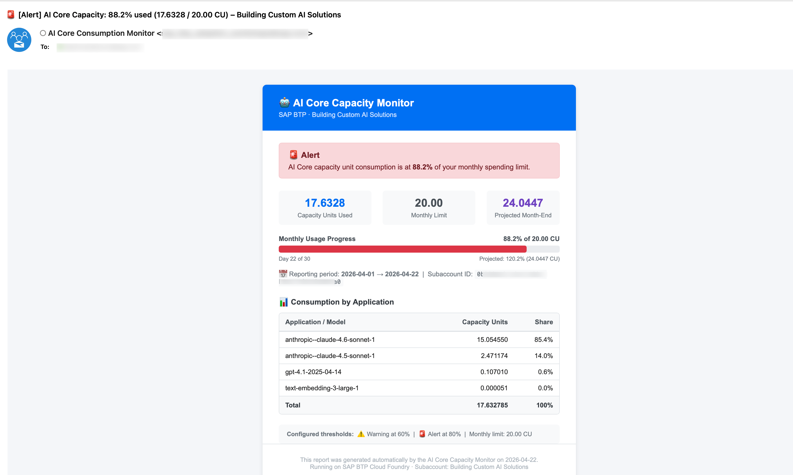

# Never Be Surprised by Your AI Core Bill Again: Building a Consumption Monitor on SAP BTP

> **📢 Note for customers on BTPEA or CPEA contracts:** SAP BTP Cockpit includes a built-in [Budgets feature](https://community.sap.com/t5/technology-blog-posts-by-sap/enhanced-finops-capabilities-for-sap-btp/ba-p/14113797) that allows global account admins to set spending thresholds and receive alerts — including for AI Core. If you have global account admin access, this is the recommended starting point. The open-source tool described in this post is complementary: it targets teams who want **daily recurring consumption updates**, **per-model capacity unit breakdown**, and **projected month-end spend** — and can be deployed by a subaccount admin without global account admin rights.

> **🔄 Update (August 2026):** The tool now supports **resource group–level monitoring**. Set `RESOURCE_GROUP=<name>` to scope consumption tracking to a specific AI Core resource group (e.g. `default`) instead of aggregating the entire subaccount. The resource group is shown in notification emails and ANS event subjects. To send alerts for different resource groups to different recipients, deploy the app multiple times — one instance per team — each with its own `RESOURCE_GROUP`, `SPENDING_LIMIT`, and `NOTIFICATION_EMAIL`. See the [README](https://github.com/SAP-samples/btp-ai-core-usage-monitor#multi-team-monitoring) for details.

If you're running AI workloads on SAP AI Core, you've probably asked yourself at some point: *"How much have we actually spent this month so far?"* The SAP BTP Cockpit shows you the numbers — but only if you remember to check. And by the time you notice something is off, the month is already over.

This post walks through an open-source tool I built to solve exactly that: **AI Core Consumption Monitor** — a lightweight Python agent that runs on SAP BTP Cloud Foundry, checks your AI Core capacity unit usage daily, and sends you a notification before you hit your budget.

> 🔗 **Open source on GitHub:** [github.com/SAP-samples/btp-ai-core-usage-monitor](https://github.com/SAP-samples/btp-ai-core-usage-monitor)  
> 🔗 **AI4U project page:** [ai4u-website.cfapps.eu10-004.hana.ondemand.com/project/btp-ai-core-usage-monitor](https://ai4u-website.cfapps.eu10-004.hana.ondemand.com/project/btp-ai-core-usage-monitor)

---

## The Problem

Consider **Dominik**, a BTP Subaccount Administrator. His developers are running RAG pipelines, orchestration workflows, and chatbots — all consuming AI Core capacity units. He has no real-time visibility into how much has been spent. By the time the monthly report arrives, tens of thousands of euros may already be gone. The result: customer shock, escalations, and eroded trust in the platform.

SAP AI Core charges by **capacity units (CU)** — a normalized metric that aggregates token consumption across all models (Claude, GPT, embedding models, etc.). The usage data is available via the SAP BTP Usage Data Management API, but there's no built-in alerting when you approach a spending threshold.

---

## What the Monitor Does

The agent runs as a background process on BTP Cloud Foundry and:

1. **Fetches** month-to-date AI Core capacity unit usage from the UAS Reporting API (OAuth2, no manual token management)
2. **Aggregates** consumption across all models and deployments
3. **Compares** against your configured monthly spending limit
4. **Sends a notification** based on the alert level:
   - ✅ **Daily update** — below warning threshold (configurable via `RECEIVE_DAILY_UPDATE_EMAILS`, default: on)
   - ⚠️ **Warning** — at 60% of limit (configurable via `WARNING_THRESHOLD_PERCENT`)
   - 🚨 **Alert** — at 80% of limit (configurable via `ALERT_THRESHOLD_PERCENT`)

The check runs automatically once a day at a configurable time (default: 07:00 UTC, set via `CHECK_TIME_UTC`). If you only want to be notified when thresholds are crossed — not every day — simply set `RECEIVE_DAILY_UPDATE_EMAILS=false`. You can also trigger a check on demand via a REST API call — useful for ad-hoc checks or integration into CI/CD pipelines.

---

## What You Get in the Email

- Colour-coded alert banner (green / amber / red)
- Three key metrics: CU used, monthly limit, projected month-end
- Visual progress bar (Outlook-compatible)
- Per-model consumption breakdown table
- Configured threshold reference



The projection is a simple linear extrapolation: if you've used X CU in the first N days of the month, you're on track to use `X / N * days_in_month` by month end. Not sophisticated, but surprisingly useful for catching runaway consumption early.

---

## Two Notification Channels

### Option A: SMTP Email

Works with any SMTP server — Office 365, Gmail, SendGrid, etc. The HTML email is built directly by the app, so you get the full rich layout regardless of your email client.

### Option B: SAP Alert Notification Service (ANS)

When `ENABLE_ANS=true`, the agent posts a structured event to the ANS Producer API. ANS then routes it to whatever channel you've configured — email, Slack, Microsoft Teams, PagerDuty, or any other action in your ANS instance.

The event carries structured tags (`subaccountId`, `percentageUsed`, `projectedCu`, `periodStart`, `periodEnd`, colour tokens) that you can use in ANS Payload Templates to build a custom HTML email directly in ANS — without any SMTP server.

---

## Architecture

```
┌─────────────────────────────────────────────────────────────┐
│  SAP BTP Cloud Foundry                                      │
│                                                             │
│  ┌──────────────────────────────────────────────────────┐   │
│  │  ai-core-monitor (Python / Flask)                    │   │
│  │                                                      │   │
│  │  APScheduler ──► run_monitoring_job() [daily 07:00]  │   │
│  │       │                                              │   │
│  │       ▼                                              │   │
│  │  UAS Reporting API ──► fetch usage (OAuth2)          │   │
│  │       │                                              │   │
│  │       ▼                                              │   │
│  │  Aggregate ai-core capacity_units                    │   │
│  │       │                                              │   │
│  │       ▼                                              │   │
│  │  Compare vs. SPENDING_LIMIT                          │   │
│  │       │                                              │   │
│  │       ├── < 60%  → INFO  (daily email if enabled)    │   │
│  │       ├── ≥ 60%  → WARNING email                     │   │
│  │       └── ≥ 80%  → ALERT email                       │   │
│  │                                                      │   │
│  │  Flask endpoints: /health  /status  /trigger         │   │
│  └──────────────────────────────────────────────────────┘   │
└─────────────────────────────────────────────────────────────┘
```

The app is a standard Python Flask application — 256 MB memory, one CF instance, no database required. It uses:

- **APScheduler** for the daily cron job
- **Requests** for the UAS and ANS API calls
- **Gunicorn** as the WSGI server
- **XSUAA** for JWT-based protection of the REST endpoints

---

<!-- ## Key Design Decisions

### Why Cloud Foundry?

The monitor itself is stateless — it fetches data, computes a result, sends a notification, and exits. CF is a natural fit: simple `cf push` deployment, automatic service binding for UAS and ANS credentials via `VCAP_SERVICES`, and no container management overhead.

### Why not use the BTP Cockpit alerts?

The BTP Cockpit does have usage alerts, but they operate at the global account level and are not specific to AI Core capacity units. This monitor is purpose-built for AI Core CU tracking with per-subaccount granularity and model-level breakdown.

### Data freshness

The UAS Reporting API has a few hours of lag — it reflects the same data you see in the BTP Cockpit under **Usage → Services**. The monitor checks once per day, so the maximum staleness in any notification is approximately 24 hours plus the SAP pipeline lag (~2–4 hours). For budget alerting purposes, this is more than sufficient.

--- -->

## Getting Started

The full deployment takes about 10 minutes:

```bash
# 1. Clone the repo
git clone https://github.com/SAP-samples/btp-ai-core-usage-monitor.git
cd btp-ai-core-usage-monitor

# 2. Create required CF services
cf create-service xsuaa application ai-core-monitor-xsuaa -c xs-security.json
cf create-service uas reporting-ga-admin uas-reporting

# 3. Edit manifest.yml — set your subaccount ID, spending limit, SMTP details
# 4. Deploy
cf push

# 5. Set your SMTP password (never in manifest.yml)
cf set-env ai-core-monitor SMTP_PASSWORD 'your-smtp-password'
cf restart ai-core-monitor

# 6. Verify
curl https://<your-app-url>/health
```

The minimum configuration is three environment variables:

```yaml
env:
  SUBACCOUNT_ID: "your-subaccount-uuid"
  SPENDING_LIMIT: "100"
  NOTIFICATION_EMAIL: "your-team@company.com"
```

The full set of configurable parameters:

| Parameter | Default | Description |
|---|---|---|
| `SUBACCOUNT_ID` | — | SAP BTP subaccount UUID to monitor |
| `SPENDING_LIMIT` | `100` | Monthly AI Core capacity unit budget |
| `WARNING_THRESHOLD_PERCENT` | `60` | % of limit that triggers a warning notification |
| `ALERT_THRESHOLD_PERCENT` | `80` | % of limit that triggers an alert notification |
| `RECEIVE_DAILY_UPDATE_EMAILS` | `true` | Send a daily summary even when below the warning threshold |
| `CHECK_TIME_UTC` | `07:00` | Time of day (UTC) to run the daily check |
| `NOTIFICATION_EMAIL` | — | Comma-separated recipient email addresses |
| `SENDER_NAME` | `AI Core Consumption Monitor` | Display name in the From field |
| `ENABLE_SMTP` | `true` | Enable SMTP email notifications |
| `SMTP_HOST` | — | SMTP server hostname (e.g. `smtp.office365.com`) |
| `SMTP_PORT` | `587` | SMTP port |
| `SMTP_USER` | — | SMTP login username |
| `SMTP_PASSWORD` | — | SMTP password (set via `cf set-env`, never in `manifest.yml`) |
| `SMTP_USE_TLS` | `true` | Use STARTTLS (`true`) or SMTP_SSL (`false`) |
| `ENABLE_ANS` | `false` | Enable SAP Alert Notification Service instead of / in addition to SMTP |
| `ANS_SERVICE_NAME` | `ai-core-monitor-ans` | CF service instance name for ANS (auto-detected if only one ANS instance is bound) |

---

## REST API

The app exposes a small REST API for operational use:

| Endpoint | Description |
|---|---|
| `GET /health` | Liveness probe (no auth) |
| `GET /status` | Last monitoring result as JSON |
| `GET /config` | Active configuration (credentials masked) |
| `POST /trigger` | Run a check immediately |

The `/trigger` endpoint accepts `{"dry_run": true}` to fetch and compute usage without sending any notifications — useful for testing your setup.

---

<!-- ## What's Next

A few things on the roadmap:

- **Hard spend limits via LiteLLM proxy** — proxying AI Core through LiteLLM on SAP Kyma would enable per-team virtual keys with `max_budget` enforcement (returning HTTP 429 when the budget is exhausted), similar to [Anthropic's customer spend limits](https://platform.claude.com/docs/en/api/rate-limits#customer-set-spend-limits). This is a separate project but a natural complement to the monitor. -->

## Try It

The project is open source under Apache 2.0:

👉 **[github.com/SAP-samples/btp-ai-core-usage-monitor](https://github.com/SAP-samples/btp-ai-core-usage-monitor)**

👉 **AI4U project page:** [ai4u-website.cfapps.eu10-004.hana.ondemand.com/project/btp-ai-core-usage-monitor](https://ai4u-website.cfapps.eu10-004.hana.ondemand.com/project/btp-ai-core-usage-monitor)

If you find it useful, have questions, or want to contribute — issues and pull requests are welcome.